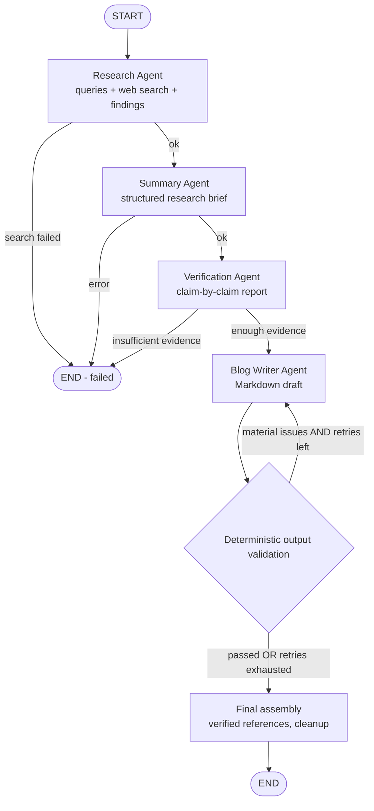

# BlogForge AI: A Terminal-Based Multi-Agent Blog Generation System

BlogForge AI takes a topic you type in the terminal, researches it on the web, summarises what it
found, checks the important claims against the retrieved sources, and writes a complete Markdown blog
with real references. Every run is saved as a Markdown blog plus JSON files describing the research
and the verification.

It is a small, readable student project. It has no web server, no GUI, no database and no Docker.

---

## Features

- **Four specialised agents** (Research, Summary, Verification, Blog Writer). They are orchestrated
  by a deterministic **LangGraph** workflow; the orchestrator itself is not an AI agent.
- **Free LLMs only** via [OpenRouter](https://openrouter.ai). The model is set in `.env`, and
  before a live run BlogForge checks that the model is listed with **$0 pricing**.
- **Real web research** with **Tavily** (free tier) when configured, with **DuckDuckGo** as a no-key
  fallback. Results are de-duplicated by normalised URL, malformed and sponsored links are dropped,
  and credible domains (government, academic, documentation) are ranked first.
- **No fabricated sources.** References are generated from retrieved search results by code, never
  by the model. Missing publication dates are stored as `null`.
- **Verification with deterministic safeguards.** Invented source IDs are removed. "Supported"
  claims that cite nothing are downgraded. Claims whose numbers do not appear in the cited sources
  are marked unsupported.
- **A bounded correction loop.** If the draft repeats unsupported claims or uses unsourced
  statistics, the same Blog Writer Agent gets one correction pass (configurable). After that, any
  offending sentences are removed.
- **Prompt-injection hardening.** Web text is sanitised and wrapped in `<untrusted_source>` blocks,
  and every agent is told to treat it as evidence only, never as instructions.
- **Explicit demonstration mode.** It needs no keys and no network, uses clearly labelled simulated
  data, and is never confused with real research.
- **Rich terminal UI**: a menu, live progress, summary tables and Markdown rendering.
- **Structured outputs**: Pydantic validation, bounded JSON repair, logs with secrets redacted, and
  73 offline tests.

---

## Architecture

```
main.py                      entry point -> app/cli.py
app/
  cli.py                     Rich menu, argparse flags, progress display
  config.py                  Settings from .env / environment (validated at startup)
  logging_config.py          File logging with secret redaction
  models.py                  Pydantic schemas (ResearchPackage, ResearchBrief, VerificationReport, ...)
  llm_client.py              OpenRouter client: timeouts, bounded retries, error mapping, JSON repair
  prompts.py                 System prompts + injection-safe source rendering
  state.py                   LangGraph TypedDict state
  graph.py                   Deterministic LangGraph workflow + bounded correction loop
  validation.py              Deterministic output validation + final Markdown assembly
  output_manager.py          Unique run folders, safe file writes, run listing
  agents/
    base.py                  Shared AgentContext (settings, LLM, search service, mode)
    research_agent.py        Agent 1
    summary_agent.py         Agent 2
    verification_agent.py    Agent 3
    blog_writer_agent.py     Agent 4
  tools/web_search.py        Tavily + DuckDuckGo research service
  demo/fixtures.py           Simulated demonstration data (clearly labelled)
  utils/text_utils.py        URL normalisation, slugs, JSON extraction, sanitising
tests/                       pytest suite (no network, no keys)
output/                      generated runs
logs/                        blogforge.log
```

### Workflow



The loop from validation back to the writer is the **only** cycle. It is bounded by
`VERIFICATION_RETRIES` (default 1, maximum 3), and LangGraph's `recursion_limit` acts as a second
safety net. The correction pass reuses the same Blog Writer Agent, receives the verification
corrections and the validation problems, and **does not** repeat research, summarising or
verification.

---

## The four agents

| Agent | Input | Output | What it does |
|---|---|---|---|
| **1. Research Agent** (`research_agent.py`) | topic, audience, constraints | `ResearchPackage` | Uses the LLM to write up to `MAX_RESEARCH_QUERIES` queries and runs them through the research service. It then extracts findings, each labelled `retrieved_evidence` or `model_interpretation` and tied to source IDs. Findings citing non-existent sources are dropped. Status is `sufficient` or `limited`. |
| **2. Summary Agent** (`summary_agent.py`) | `ResearchPackage` | `ResearchBrief` | Groups and de-duplicates findings, explains terms, and keeps disagreements and limitations. Every evidence item must cite real source IDs; invented IDs are removed. |
| **3. Verification Agent** (`verification_agent.py`) | package + brief | `VerificationReport` | Extracts important claims and rates each as `supported`, `partially_supported`, `unsupported`, `contradictory` or `unverifiable`, with an explanation and a correction. Deterministic rules then make the verdicts more conservative. It also computes source coverage. |
| **4. Blog Writer Agent** (`blog_writer_agent.py`) | package, brief, report, word count, audience, tone (+ feedback) | `BlogDraft` | Writes an SEO-friendly title, description, keywords, introduction, H2/H3 sections, examples, practical implications and conclusion, with inline `[S1]` citations. It follows the verification report and does not write references itself. |

**Source coverage method** (also stored in `verification.json`):
- `claim_support_ratio` = (supported + partially supported claims) / claims checked.
- `source_utilization_ratio` = distinct retrieved sources cited by a supported or partially
  supported claim / total retrieved sources.

**Overall verification status:**
- `insufficient_evidence` if no claim is at least partially supported. The run stops here.
- `needs_revision` if any claim is unsupported or contradictory.
- `pass_with_warnings` if any claim is partial or unverifiable.
- `pass` otherwise.

**Deterministic output validation** checks the draft for:
- the Introduction and Conclusion sections and at least 4 H2 sections;
- citations to unknown source IDs;
- URLs that were not retrieved;
- sentences that restate unsupported or contradictory claims;
- percentages that appear in no retrieved source.

Length and H3 usage are checked as warnings only.

---

## Technology stack

Python 3.11+ · LangGraph · OpenAI Python SDK (pointed at OpenRouter's OpenAI-compatible API) ·
Pydantic v2 · python-dotenv · Rich · tavily-python · ddgs (DuckDuckGo) · httpx · pytest · logging

---

## Prerequisites

- Python **3.11 or newer** (`python --version`)
- Internet access for live mode (demonstration mode works offline)
- A free OpenRouter account for live mode; a Tavily account is optional

---

## Installation

### Windows (PowerShell)

```powershell
cd "C:\path\to\BlogForge"
python -m venv .venv
.\.venv\Scripts\Activate.ps1
python -m pip install --upgrade pip
pip install -r requirements.txt
Copy-Item .env.example .env
```

If PowerShell blocks activation, run this once:
`Set-ExecutionPolicy -Scope CurrentUser RemoteSigned`.
You can also skip activation and call `.\.venv\Scripts\python.exe` directly.

### macOS / Linux

```bash
cd /path/to/BlogForge
python3 -m venv .venv
source .venv/bin/activate
python -m pip install --upgrade pip
pip install -r requirements.txt
cp .env.example .env
```

---

## Environment configuration

Edit `.env`. Never commit it; it is already in `.gitignore`.

| Variable | Default | Meaning |
|---|---|---|
| `OPENROUTER_API_KEY` | – | Your OpenRouter key (required for live mode) |
| `OPENROUTER_MODEL` | – | ID of a **currently available free** model (required for live mode) |
| `TAVILY_API_KEY` | – | Optional; without it DuckDuckGo is used |
| `BLOG_OUTPUT_DIR` | `output` | Where runs are saved (must be inside the project folder) |
| `MAX_SEARCH_RESULTS` | `8` | Maximum sources kept after de-duplication (1–20) |
| `MAX_RESEARCH_QUERIES` | `3` | Search queries per run (1–5) |
| `BLOG_WORD_COUNT` | `1200` | Default target length (300–5000) |
| `VERIFICATION_RETRIES` | `1` | Writer correction passes allowed (0–3) |
| `REQUEST_TIMEOUT` | `30` | Network timeout in seconds (5–120) |
| `LOG_LEVEL` | `INFO` | DEBUG, INFO, WARNING, ERROR or CRITICAL |

Invalid values stop the app at startup with a clear message. Real environment variables override
values in `.env`.

### Getting an OpenRouter API key

1. Sign up at <https://openrouter.ai>.
2. Open <https://openrouter.ai/keys>, create a key and paste it into `OPENROUTER_API_KEY`.

### Choosing an available free model

1. Open <https://openrouter.ai/models> and filter by **Prompt pricing: FREE**.
2. Copy the model ID (for example something ending in `:free`) into `OPENROUTER_MODEL`.
3. Run `python main.py --check`. It looks the model up in OpenRouter's public model list and
   confirms it is available and priced at $0.

Free models change often, so this project does not hard-code one. A name containing "free" is not
trusted: BlogForge checks the listed price and **refuses to run with a paid model**. Free models
have rate limits and daily quotas. When they are exhausted, BlogForge reports the 429 or 402 error
clearly instead of switching to another model.

### Configuring Tavily (optional)

Create a free account at <https://tavily.com>, copy your API key into `TAVILY_API_KEY`, and run
`python main.py --check`.

### DuckDuckGo fallback

Without a Tavily key, or if every Tavily query fails, BlogForge searches DuckDuckGo through the
`ddgs` package. No key is needed. Queries are spaced one second apart and each failed query is
retried once. DuckDuckGo may rate-limit heavy use. The provider actually used is shown in the
terminal and stored in `research.json`. If **all** providers fail, the run stops with an error; it
never invents results or quietly switches to simulated data.

---

## Running the application

**Interactive menu:**

```bash
python main.py
```

```
1. Generate a new blog
2. View previously generated blogs
3. View the latest research and verification report
4. Run a system configuration check
5. Exit
```

**Command line:**

```bash
python main.py --topic "How Agentic AI Works"
python main.py --topic "How Agentic AI Works" --audience "students" --tone "friendly" --words 1000 --show
python main.py --check        # configuration check (exit code 0 = live mode ready)
```

`--show` prints the finished blog in the terminal. Without it, the command-line run only prints the
summary and file paths.

**Demonstration mode** (no API keys, no network):

```bash
python main.py --demo
python main.py --demo --topic "Edge Computing"
```

The terminal and the generated blog both state:

> DEMONSTRATION MODE: Using simulated data. No live web research or real factual verification is being performed.

In demo mode:
- all sources are labelled `[SIMULATED]`, flagged `"simulated": true`, and use the reserved
  `.invalid` domain, so they cannot be mistaken for real pages;
- deterministic templates replace the LLM;
- the first draft deliberately includes one claim the simulated report marked unsupported, so you
  can watch the correction loop run.

Demo templates have a fixed length and ignore the word count.

If live mode is not configured, the interactive menu explains how to configure it and asks whether
to run an explicit demonstration instead. `--topic` without configuration exits with an error. It
never falls back silently.

---

## Running the tests

```bash
python -m pytest -q
```

The suite is deterministic and fully offline. A fixture blocks socket connections, the LLM is a
scripted fake, and search providers are mocked. It covers:
- configuration and missing keys;
- model validation and source-ID references;
- URL validation and de-duplication;
- the provider fallback;
- prompt-injection sanitising;
- each agent;
- OpenRouter error handling and bounded retries;
- JSON repair;
- the free-model check;
- the full LangGraph workflow, including correction routing, retry limits and infinite-loop
  prevention;
- empty-search failure and the insufficient-evidence stop;
- demo mode without keys;
- output folders, safe filenames and JSON validity.

---

## Output structure

Each run gets its own folder. A second run on the same topic and day gets a `-2` suffix, so nothing
is overwritten:

```
output/
  2026-10-15-how-agentic-ai-works/
    blog.md              the blog (title, description, keywords, sections, references)
    research.json        ResearchPackage: queries, sources (id, title, url, snippet, date, retrieved_at), findings
    summary.json         ResearchBrief
    verification.json    VerificationReport: every claim, its status, sources, corrections, coverage
    run_metadata.json    start/end/elapsed time, model, search provider, per-agent status, retries, errors, warnings
```

If a run fails, `run_metadata.json` and any finished intermediate files are still saved to help with
troubleshooting. Logs go to `logs/blogforge.log`, with API keys redacted.

---

## Known limitations

- **Snippet-level evidence.** Agents see search snippets or extracts, not full articles, so
  nuance can be lost.
- **Model quality varies.** Small free models may produce weaker structure or more cautious
  verdicts. Invalid JSON gets one repair attempt, then the run stops with an error.
- **Heuristic credibility ranking.** Source ranking is based on domain heuristics, not a real
  reputation score.
- **Simple claim matching.** Unsupported-claim detection in drafts uses word overlap, so heavily
  reworded claims can slip through; a human review is still needed.
- **Quotas and rate limits.** Free-tier limits on OpenRouter, Tavily and DuckDuckGo can interrupt
  runs.
- **Fixed demo length.** Demo mode shows how the pipeline works; its content is not meaningful.

## Automated verification does not guarantee truth

The Verification Agent judges claims **only against the retrieved snippets**. A language model's
confidence is not evidence, a URL alone does not prove a claim, and several websites repeating
something does not make it true. "Supported" means "a retrieved snippet appears to state this",
not "this is correct". Always review the blog and its references before publishing.

---

## Troubleshooting

| Problem | Fix |
|---|---|
| `Missing configuration: OPENROUTER_API_KEY, OPENROUTER_MODEL` | Copy `.env.example` to `.env` and fill both values, or use `--demo`. |
| `Model '...' is not in OpenRouter's current model list` | The free model was retired. Pick another free model at openrouter.ai/models. |
| `... is available but NOT free` | Choose a model whose prompt and completion prices are both 0. |
| `401` / `rejected the API key` | Regenerate the key and check `.env` for extra spaces or quotes. |
| `429` / `rate limit or free-tier quota` | Wait a few minutes, lower `MAX_RESEARCH_QUERIES`, or switch to another free model. |
| `402` / `insufficient credits` | Free-tier quota is exhausted or the model is not free. |
| `Web research failed` | Check your internet connection. Add a `TAVILY_API_KEY`, or wait if DuckDuckGo is rate-limiting. |
| `invalid structured data` | The free model returned malformed JSON twice. Retry, or choose a stronger free model. |
| `retrieved evidence does not support the brief's claims` | Use a more specific topic, or configure Tavily for better sources. |
| Garbled symbols in old Windows consoles | Use Windows Terminal, or run `chcp 65001` first. |
| PowerShell will not activate the venv | `Set-ExecutionPolicy -Scope CurrentUser RemoteSigned` |
